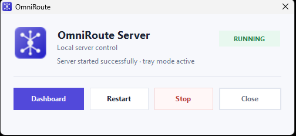
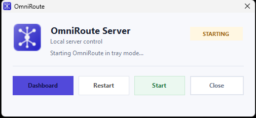
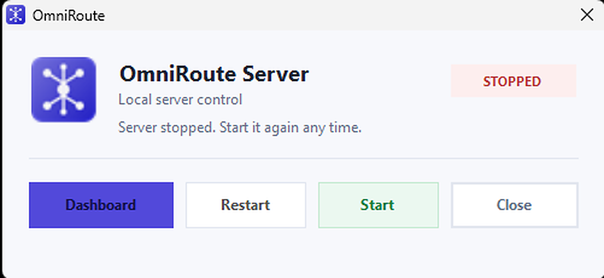

<p align="center">
  
</p>

<h1 align="center">OmniRoute Console</h1>

<p align="center">
  <strong>High-performance, ultra-lightweight Windows companion &amp; system tray controller for the OmniRoute local AI router (<code>127.0.0.1:20128</code>).</strong>
</p>

<p align="center">
  <a href="https://github.com/krishna-techhub/OmniRoute-Console/releases"></a>
  
  
  
  <a href="LICENSE"></a>
</p>

---

## ⚡ Installation

Choose the deployment method that fits your workflow:

### Option 1: Standalone Windows Setup Wizard *(Recommended)*
Download and launch the zero-dependency graphical installer (~160 KB). It extracts the embedded application payload, registers Desktop and Start Menu shortcuts, and flushes the Windows Explorer icon cache:

<p align="left">
  <a href="https://raw.githubusercontent.com/krishna-techhub/OmniRoute-Console/main/dist/OmniRouteConsole-Setup.exe">
    
  </a>
  &nbsp;&nbsp;
  <a href="https://raw.githubusercontent.com/krishna-techhub/OmniRoute-Console/main/dist/OmniRouteConsole.exe">
    
  </a>
</p>

| Binary Package | Type | Architecture | File Size | Direct Download Link |
| :--- | :--- | :--- | :--- | :--- |
| **`OmniRouteConsole-Setup.exe`** | GUI Setup Wizard *(Recommended)* | Windows 10 / 11 (x64) | **~160 KB** | [**⬇️ Download Setup.exe**](https://raw.githubusercontent.com/krishna-techhub/OmniRoute-Console/main/dist/OmniRouteConsole-Setup.exe) |
| **`OmniRouteConsole.exe`** | Standalone Portable Executable | Windows 10 / 11 (x64) | **~64 KB** | [**⬇️ Download Binary.exe**](https://raw.githubusercontent.com/krishna-techhub/OmniRoute-Console/main/dist/OmniRouteConsole.exe) |

---

### Option 2: Windows PowerShell One-Liner
Run in any standard PowerShell window:
```powershell
irm https://raw.githubusercontent.com/krishna-techhub/OmniRoute-Console/main/install.ps1 | iex
```

### Option 3: Command Prompt (CMD)
Run in standard `cmd.exe`:
```cmd
curl -fsSL https://raw.githubusercontent.com/krishna-techhub/OmniRoute-Console/main/install.cmd -o install.cmd && install.cmd && del install.cmd
```

---

## 📸 Interface Preview

<div align="center">

### 🟢 Online State & Live Latency Indicator


<br/><br/>

### 🟡 Connecting Probe (Background Launch)


<br/><br/>

### 🔴 Offline Standby


</div>

---

## 🏛️ Architecture & System Design

OmniRoute Console runs as a native Win32 GUI companion that decouples server management from terminal sessions, avoiding dangling console windows while providing instant loopback telemetry.

```text
               +--------------------------------------------+
               |  OmniRoute Console (64 KB Native PE Win32) |
               +--------------------------------------------+
                                     |
               +---------------------+----------------------+
               |                                            |
               v                                            v
     [Non-Blocking TCP Socket]                    [Detached Subprocess]
     Probes 127.0.0.1:20128                       Spawns: omniroute serve --tray
     - Sub-35ms round-trip ping                   - Environment PATH enriched
     - Real-time latency tracking                 - No persistent console windows
               |                                            |
               v                                            v
     [Windows System Tray]                       [Default Web Browser]
     - Right-click context menu                  Direct to http://localhost:20128/home
     - Online / Offline tooltip
```

---

## 🚀 Key Features

* **Sub-70KB Footprint**: Pure native WinForms / C# binary compiled via Windows native `csc.exe`. Zero Electron, zero WebView2, zero Node.js runtime required to operate the launcher.
* **Persistent System Tray Controller**: Minimizes cleanly to the Windows notification tray. Right-click context menu provides instant access to **Open Dashboard**, **Restart Server**, **Stop / Start**, and **Exit**.
* **Live Latency & Health Probing**: Asynchronous non-blocking loopback TCP socket polling measures round-trip response time in milliseconds without UI freezes.
* **Background Process Decoupling**: Launches the Node CLI silently (`cmd.exe /c omniroute serve --tray`) with `%APPDATA%\npm` and Node.js environment paths automatically resolved.
* **Smart Auto-Close & Hover Cancellation**: Auto-dismisses after 5 seconds if the server is healthy. Any mouse hover or cursor movement over the window instantly cancels the countdown.
* **Background Auto-Update Detection**: Silently checks for newer releases and surfaces a non-intrusive update indicator.
* **Explorer Icon Cache Synchronization**: Uses Windows Shell P/Invoke (`SHChangeNotify`) to ensure newly created shortcuts render high-resolution icons immediately without a system reboot.

---

## ⌨️ Controls & Keyboard Shortcuts

| Shortcut / Button | Action | Behavior |
|---|---|---|
| <kbd>Enter</kbd> / **Dashboard** | Open Web Dashboard | Launches default browser directly to `http://localhost:20128/home`. |
| <kbd>Space</kbd> / **Toggle** | Start / Stop Server | Manually toggles background server state. |
| **Restart** | Graceful Restart | Stops running instance, waits for socket release, and restarts silently. |
| <kbd>Esc</kbd> / **Close** | Send to System Tray | Hides window to system tray; background server continues running. |
| **Tray Context Menu** | Quick Controller | Right-click the purple tray icon to control server state or exit. |

---

## 🛠️ Building from Source

No third-party SDKs, MSBuild, or Visual Studio installations are required. Compiles using the native C# compiler pre-installed with Windows:

### 1. Compile Main Launcher (`OmniRouteConsole.exe`)
```powershell
powershell -ExecutionPolicy Bypass -File .\build.ps1
```

### 2. Compile Standalone Setup Wizard (`OmniRouteConsole-Setup.exe`)
```powershell
powershell -ExecutionPolicy Bypass -File .\build-installer.ps1
```

Both build scripts utilize `C:\Windows\Microsoft.NET\Framework64\v4.0.30319\csc.exe` and embed the high-DPI multi-resolution icon (`assets/omniroute.ico`).

---

## 🗑️ Clean Uninstallation

To cleanly stop active console instances and remove `%LOCALAPPDATA%\OmniRouteConsole` along with Desktop and Start Menu shortcuts:

```powershell
irm https://raw.githubusercontent.com/krishna-techhub/OmniRoute-Console/main/uninstall.ps1 | iex
```

---

## 📄 License & Maintainer

* **Author**: [krishna-techhub](https://github.com/krishna-techhub)
* **License**: [MIT](LICENSE)
